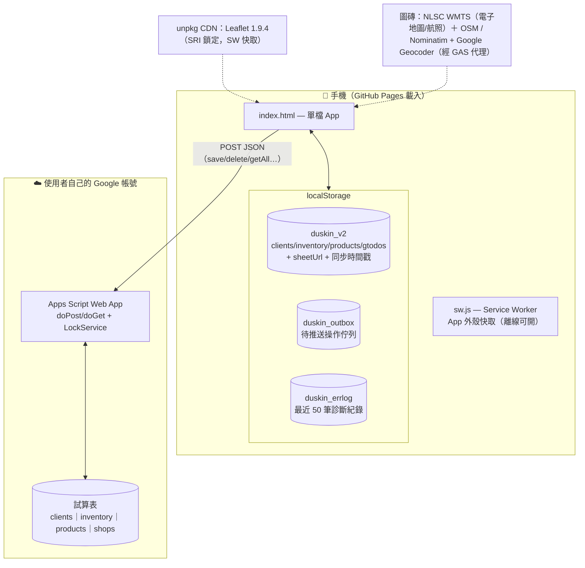
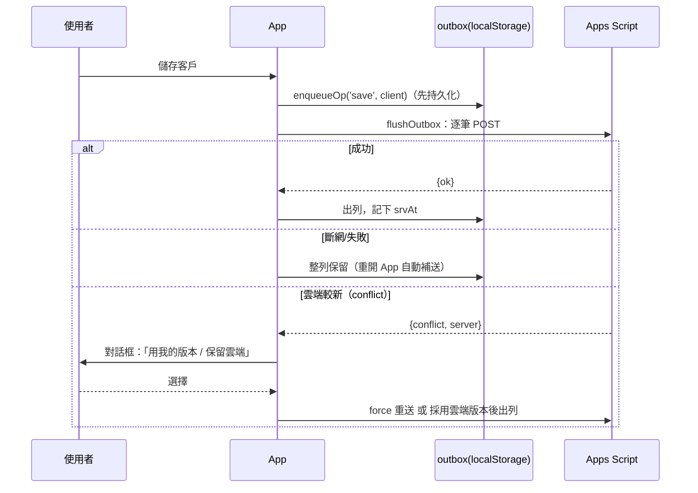

# 技術架構

> 給開發者／維護者的深入文件。使用者請看 [GUIDE.md](../GUIDE.md)；開發慣例請看 [CLAUDE.md](../CLAUDE.md)。

## 目錄

1. [設計理念](#設計理念)
2. [系統組成](#系統組成)
3. [index.html 內部地圖](#indexhtml-內部地圖)
4. [資料模型](#資料模型)
5. [同步機制（outbox／增量／衝突）](#同步機制)
6. [後端：內嵌 Apps Script](#後端內嵌-apps-script)
7. [PWA 與快取策略](#pwa-與快取策略)
8. [UI 系統](#ui-系統)
9. [測試架構](#測試架構)
10. [發版流程](#發版流程)

---

## 設計理念

三個前提決定了所有架構選擇：

1. **使用者非技術背景**——部署、更新、備份都必須「照著做就會」。
2. **外勤情境**——隧道裡、地下室、收訊差的工業區，App 必須離線完整可用。
3. **零預算**——不租伺服器、不買資料庫。

因此：

| 選擇 | 原因 |
|------|------|
| 單一 `index.html`（無框架、無 build） | 部署＝上傳一個檔案；更新檢查＝比對一行 `APP_VERSION` 字串；永遠不會「build 壞了」 |
| `localStorage` 為主資料庫 | 離線完整讀寫；容量對單一業務員的客戶量綽綽有餘 |
| Google Sheets 當雲端後端 | 免費、使用者看得懂自己的資料、主管能直接開試算表看 |
| Apps Script 程式碼**內嵌在前端** | 使用者「複製 → 貼上 → 部署」即完成後端，不用碰 git |
| outbox 待推送佇列 | 收訊差時的寫入絕不能默默消失 |

---

## 系統組成



---

## index.html 內部地圖

整個 App 約 7,900 行，依序分為四大塊。每個區段都有 `═══` 橫幅註解，可用搜尋直接跳轉：

```
index.html
├─ <style>（~25–530 行）
│   DESIGN TOKENS（CSS 變數：品牌色/語意色/狀態徽章色票，含深色模式覆寫）
│   BASE / FORM CONTROLS / BUTTONS / CARD / BADGE / TODO / MOOD / PILL
│   ALERT / TABLE / MODAL / APP TOAST·DIALOG / TODO QUICK-ADD / NAVIGATION
│   MAP / CONTRACT-MAKER（cm-*）
│
├─ <body>（~530–1410 行）
│   六個 .panel（clients/daily/todos/shops/inventory/settings）
│   ＋共用 modal（狀態篩選、商品、庫存、待辦、版本選單、dedup、admin）
│   ＋報價精靈（#cm-modal）與合約精靈（#cm-wiz）全頁 overlay
│
└─ <script>（~1410–7900 行，單一 script，搜尋「═══」橫幅導覽）
    APPS SCRIPT CODE      內嵌後端原始碼（字串常數，供一鍵複製部署）
    預設商品資料           DEFAULT_PRODUCTS / INV_INIT / BUNDLE_MAP 配件規則
    STATE & PERSISTENCE   STATUS 常數、DB、saveLocal/loadLocal、錯誤紀錄、outbox
    SYNC                  api()/autoSync()/flushOutbox()/syncFromSheet()/衝突處理
    NAV                   navTo() 分頁切換
    PRODUCTS PANEL        商品資料庫 CRUD
    MIGRATION             啟動時資料不變式檢查與自動修正
    DEDUP                 重複店家掃描／合併（含雲端清理）
    全域 UI               showToast / appAlert / appConfirm / 全域 Esc 關 modal
    SHOPS SEARCH          查詢頁（公司既有客戶，含四週營業額）
    CLIENT LIST / MAP     列表（分頁渲染）與 Leaflet 地圖（geocode 佇列＋
                          工地地圖模式：FAB「＋在這裡建檔」GPS 抓點→拖圖釘→建檔，座標標 manual）
    CLIENT FORM / DETAIL  建檔表單精靈、詳情頁（拜訪/品項/待辦）
    DAILY / REPORT        日報與 4W 推進表產生器
    GLOBAL TODOS          Todoist 式：parseQuickTodo 解析器＋分區清單
    SITE HANDOFF          工地地圖交接信箱消化（consumeSiteHandoff）＋主系統端「轉為客戶」（mainConvertSite）
    EXPORT / VERSION      JSON 備份、版本檢查（輪詢線上 APP_VERSION）
    ADMIN DASHBOARD       ?admin=1 長官唯讀彙總
    INIT                  啟動序：載資料→migration→render→自動同步
    CONTRACTMAKER 模組    報價單/合約 .docx 產生器（IIFE 模組，docx 套件 CDN 懶載入）
    TEST MODE             ?test=1 純函式自我測試
```

---

## 資料模型

所有資料以 JSON 形式存於 `localStorage.duskin_v2`，結構如下：

```js
{
  clients: [Client], inventory: [Item], products: [Product], gtodos: [Todo],
  profile, profileAcked,            // 業務個人資料（僅本機）
  sheetUrl, lastSyncAt, lastPullAt, pending
}
```

### Profile（業務個人資料，僅本機・不上雲）

```js
profile: { office, dept, contact, mobile, phone, fax, email, address,
           salesId, title, seal }
//  salesId 業務編號、title 職稱、seal 電子簽名/印章圖檔（data URL）—皆選填，印在合約乙方欄
```

報價單／合約上「承辦人（乙方）」的唯一資料來源。各業務各自獨立部署（自己的 Sheet＋localStorage），
故 profile 只存本機、不參與雲端同步，但含於 JSON 匯出／匯入。`profile=null` 時 `getProfile()`
回退 `DEFAULT_PROFILE`（潘秉均／台南營業所），潘本人升級無需重填。

- **單一出入口**：`getProfile()` 合併 `DB.profile` 與 `DEFAULT_PROFILE`；ContractMaker 模組透過注入的
  `HOST.getProfile()` 取用（`CM_builder.companyInfo` 與 `cmCompany()` 皆即時讀取，不再寫死）。
- **首次引導**：`profileNeedsSetup()`（承辦人＋手機仍為預設且 `profileAcked=false`）為真時，
  進入報價單／合約前 `ensureDocAuthor()` 跳一次確認，引導去設定頁填寫；填寫或選「就用預設」後設 `profileAcked`，不再每次提醒。
- **印章圖檔**：`seal` 為 data URL，合約 `ctSigners()` 以 docx `ImageRun` 內嵌於乙方欄（`cmDataUrlToBytes()` 轉 Uint8Array；壞圖 try/catch 跳過，不擋合約產生）。
- **上手檢查清單**（設定頁 `renderOnboardChecklist()`）：個人資料／雲端連線／試算表命名三步狀態。
  第三步靠 `refreshSheetIdentity()` 呼叫自己 Sheet 的 `getSnapshot` 取回試算表檔名，與 `profile.contact` 比對——
  因為**主管儀表板（`?admin=1`）以試算表檔名辨識業務員**（後端 `getSnapshot()` 回 `ss.getName()`），
  兩者不一致會在彙總顯示錯誤姓名，故在此提醒對齊。

### 多業務模式（路線 A：各自獨立部署）

擴大給多位業務時採「**單一共用部署 + 各自雲端**」：所有人開同一份 GitHub Pages，各自設定自己的 Sheet URL
與 profile，資料天然隔離。主管彙總（`?admin=1` 長官儀表板）貼多個 Sheet URL 並行抓 `getSnapshot` 合併。
**勿各自 fork**（會造成版本分裂、`checkForUpdate` 各看各的）。離職交接靠轉移 Sheet 擁有權或 JSON 匯出（資料在各自 Google 帳號）。

### Client（客戶，同步雲端 clients 分頁）

```js
{
  id,                    // UUID（crypto.randomUUID，雲端 upsert 的 key）
  name, addr, type, status,        // status ∈ STATUS 常數表：待拜訪｜開發中｜試用｜成約｜擱置（見下方「階段與判斷」）
  quoted,                          // 已報價（bool）
  handoff, handoffReason, handoffFrom,   // ''待轉交｜'done'已轉交｜'blocked'無法轉交＋理由；handoffFrom＝重新起算 10 天的日期
  need, tier,                      // 需求判斷 ''|'有'|'無'|'未定'、評價 0|1|2|3
  shelveReason, shelvedAt, wakeDate, wokeAt,   // 擱置理由／擱置日／喚醒日／上次被喚醒的日期
  contact, phone, regNo,           // regNo＝統一編號（去重時的身分鍵）
  nextdate, env, note,
  lat, lng, geocodeSource,         // 地圖定位（manual / geocode_ok / failed）
  trials: [{ n, start, due, items:[{product, qty, cycle, quoted, bundledTo?, bundleRole?}],
             open, recovered, result }],   // 每次試用一筆，見下方「試用」
  contractedItems: [{…同上, contractDate}],
  visits: [{date, mood(1-4), note, insight, statusChange, nextdate}],
  todos:  [Todo],
  updatedAt,             // 本機最後修改（衝突偵測比對值）
  srvAt                  // 雲端已確認版本的時間戳（同步基準）
}
```

### 階段與判斷（五階段＋獨立欄位）

舊的九個狀態把三件事塞在同一欄：走到哪了（階段）、值得花多少力氣（評價）、下一步是什麼（提醒）。現在拆開：

| 階段 `status` | 子狀態（獨立欄位） | 系統給的下一步 |
|---|---|---|
| 待拜訪 | — | 進排程池（清單依區域 → 評價排序）|
| 開發中 | `need`、`quoted` | 記拜訪自動排下次（＋7 天）；`need='無'` → 轉擱置；已報價 → `quote-followup` |
| 試用 | `quoted` | 回收待辦（`auto-recycle`）；未報價 → `auto-quote`「安排報價」；已報價 → `quote-followup` |
| 成約 | `handoff`、`handoffReason` | 待轉交 → `handoff` 待辦（成約日＋10 天）；無法轉交 → `handoff-check` 待辦（每 14 天：自己送貨＋理由還在嗎）。「待轉交」分類＝`handoff!=='done'`，依成約日排序 |
| 擱置 | `shelveReason`、`wakeDate` | `wakeShelved()`：喚醒日到了改回待拜訪（記 `wokeAt`）|

| 入口 | 語意 |
|------|------|
| `statusLabel(c)`／`clientPill(c)`／`clientTone(c)` | 客戶的狀態文字（含括號子狀態）、圓點＋粗字、急迫度色。**顯示客戶狀態一律走這三個**，`statusStyle(t)` 只給純階段字串（拜訪紀錄的徽章）|
| `inPipeline(c)` | 試用、或開發中但已報價——日報推進表與長官儀表板「試用」的口徑 |
| `markQuoted(c,date)` | 設 `quoted`、關掉 `auto-quote`、補一筆一週後的 `quote-followup`（已有未完成的不重複）|
| `shelveClient(c,reason,date)` | 轉擱置：理由、擱置日、`wakeDate=wakeDateFor(c)`（`WAKE_MONTHS={1:4,2:8}`，三級不提醒）、清下次拜訪日、關掉報價類待辦 |
| `checkQuoteFollowups()` | 已報價且追蹤到期 → 問要不要擱置（每週一次）；**還有進行中的試用就不問**（由回收流程收尾）|
| `syncHandoffTodo(c)`／`setHandoff(c,state,reason)` | 轉交待辦的唯一入口（冪等）：依 `c.handoff` 開關 `handoff`／`handoff-check` 兩種系統待辦。啟動時 `syncAllHandoffTodos()` 全掃，各轉換點（回收成約、存表單、記拜訪、勾待辦）單筆呼叫。`HANDOFF_DAYS=10`、`HANDOFF_RECHECK_DAYS=14` |
| `onTodoToggled(c,t)` | 勾掉 `handoff` 待辦＝已轉交；勾掉 `handoff-check`＝這次送完，自動補下一次 |
| `checkHandoffRechecks()` | 無法轉交的確認到期 → 問理由還在不在：還在 → 14 天後再問；不在了 → 回待轉交，10 天從當天重算 |
| `missingFields(c)` | 還缺的判斷：非待拜訪都要 `tier`；開發中要 `need`；擱置要 `shelveReason` |
| `openFill(only?)`／`fillNext()`／`renderFillBanner()` | 補資料視窗：啟動 0.8 秒後自動跳出、一家一家問；可稍後再填，清單上方留提示條。填 `need='無'` 的開發中會直接轉擱置 |
| `packStage(c)`／`packAllStages(list)` | 舊九狀態 → 五階段＋欄位，連同 `visits[].statusChange`（舊「報價」變成 `visit.quoted`）。冪等；migration v13、`validateClients()` 與所有資料進入點都呼叫，**必須排在 `packTrials` 之後**（要看有沒有試用紀錄）。不重推上雲、不動 `updatedAt` |
| `rptVisitAction(c,v)` | 日報動作代號：擱置＝拒、`v.quoted`＝報、試用／成約＝試；其餘看是不是這家店最早的一筆拜訪（初／複）|

記錄拜訪（`saveVL`）先驗證再動資料：一定要有評價；結果是開發中就要有需求判斷；選擱置要有理由。待拜訪的店記了拜訪自動變開發中。

### 批次報價單

待辦頁「批次報價單」：把該報價的店一次產成**一個 Word 檔、一家一頁**，傳到電腦列印。職責照模組邊界切兩半：

- **主程式挑店**：`quoteNeeded(c)`＝試用且未報價，或有未完成的報價類待辦（`source:'auto-quote'`，或文字含「報價」；`quote-followup` 不算；擱置與成約不列）。`batchQuoteList()` 逐家向模組要內容，出不了的帶原因（多半是客戶卡沒有品項）；依評價排序。
- **模組出內容**：`ContractMaker.quoteInfo(c)`（品項＋四週合計，出不了 throw）與 `ContractMaker.saveQuotes(clients, filename)`（`CM_builder.buildBatchBlob`：每份報價單一個 section，內容與單張共用 `quoteChildren`；存檔走既有的 `cmTriggerSave`，iOS 是分享面板）。
- **只產檔、不改資料**：印出來不等於交給客戶，「已報價」仍由使用者自己標；也不補拜訪紀錄。

### 訂製地墊試算（`omm*`）

針織訂製地墊（OMM）的價格由「尺寸 × 顏色數」決定。`OMM_PRICE` 是公司 2021/03 訂製地墊價格表的針織部分：
五個系列（`HSO` 1 色／`HP` 2 色／`HH` 2 色反轉／`HQ` 3-4 色／`HR` 5-6 色），各有制式尺寸 6 個價與自由尺寸 No.1–20，每格＝標準單價（更換一次）。
價格表上的「特製費」由公司吸收、不對客戶列出（使用者指定），所以沒有收進來。

- `ommArea(w,l)`：面積（m²）四捨五入到小數第 2 位；`ommRank(area)`：每 0.6 m² 一級（≤0.60＝No.1 … 11.41–12.00＝No.20）。
- `ommQuote(series,size)`：`size` 是制式代號或 `{w,l}`（公分）→ `{code,desc,category,dims,area,unit,fw4}`；超出針織限制（`OMM_MAX`：短邊 180、長邊 1000、12 m²）回 `error`。
  **四週金額固定＝標準單價 × 2**（使用者指定：報價一律用四週更換兩次）。同樣大小走制式與走自由尺寸價格不同，由使用者選。
- **分類與命名**（使用者指定，`ommProductData(code)` 是唯一來源；`ommParse(code)` 判斷記號是不是訂製地墊）：

  | | 分類 `series` | 記號 `code` | 規格 `size` | 名稱 `desc` |
  |---|---|---|---|---|
  | 制式尺寸 | 訂製地墊・制式 | 系列字頭＋尺寸：`HPL` | `L` | 訂作地墊 2 色 制式 L（90×150 公分） |
  | 自由尺寸 | 訂製地墊・3-4 色（依顏色數） | 系列字頭＋No.：`HQ8` | `NO.8` | 訂作地墊 3-4 色 NO.8（4.21–4.80 m²） |

  商品庫裡訂製地墊之間照 `ommSortKey` 排（制式小→大，再來各顏色數 No. 小→大；`ommSortProducts()` 只重排訂製地墊，其他商品原位不動）。
  `ensureProductBaseline()` 會把分類還是舊的（如「訂做系列」）訂製地墊改成這套；分類已對的不再動，使用者之後自己改的名稱不會被蓋。
- **這是價目規則，不是第二份商品清單**：一百多個代號不預先放進 `DB.products`（商品整包存 Sheet 一格，有 5 萬字上限）。`ommAddProduct()` 只把試算出的那一個記號寫進商品庫，之後客戶卡／報價／合約照舊只讀 `DB.products`。

### 公司試用表比對（`serve*`）

匯入公司系統的「SERVE別試用顧客一覽表」（.xlsx），和本機 `c.trials` 逐筆對照。**只列落差、不自動改資料**；每筆由使用者按「照公司的」才寫入。

- **讀檔**：`loadXLSX()` 首次使用時才載入 `vendor/xlsx.mini.min.js`（SheetJS 0.20.3，已進 `sw.js` 的 SHELL 可離線）。`parseServeRows(rows)` 吃二維陣列（與函式庫無關）：以「試用單號」找表頭列、依欄名定位；單號列開一張單，其下每列一個商品；略過「合計／總合計」。**只回傳狀態「未回收」的單**（使用者指定；`skipped`＝略過的已回收張數）。
- **資料**：匯入結果只存本機 `localStorage.duskin_serve`（每週重匯）；配對成功後公司顧客編號記在 `c.custNo`（隨客戶同步）。
- **配對** `serveFindClient(o)`：`custNo` → 電話（只比數字）唯一相同 → 名稱去掉公司字尾後唯一相同。配不上的由使用者指定（候選按鈕或 `serveSearch` 搜尋店名／地址／電話／窗口 → `serveLink`）或 `serveCreate` 建新客戶。
- **落差** `serveDiff(data)`：`nomatch`／`missing`（公司有你沒記）／`diff`（`serveCompare`：試用日、回收預定日、回收狀態、主商品、整單 4W 合計）／`extra`（期間內你還在試用、公司未回收清單沒有）。公司單與本機試用以試用日配對，容許 ±3 天。
- **主商品以本機商品主檔為準**（`serveIsMain`：`note` 不是配件／口味）。公司把芳香機的錢記在口味那行、機台記 0，本機相反，所以品項只比主商品、金額比整張單合計。
- **寫入** `serveApply(no)`：只動那一筆試用（日期、品項、改回進行中），同代號保留原本的議價與週期；補進來的依試用日重排並重編 `n`，待辦的 `trialN` 跟著換；因此變成還在試用的店會轉為試用並補一筆拜訪紀錄。
- **週報金額規則**（使用者指定）：`genReport()` 推進表現在會列區間內成約的店，金額＝成約品項 4W 合計 ÷ `RPT_TAX`(1.05)、進度說明「成約」；試用中的維持含稅。**解約尚未建模**（等公司成約／解約報表樣本）。

### Google 日曆同步（提醒走出 App）

PWA 在 iOS 沒有排程通知也做不出小工具，所以把「有日期的下一步」放進使用者自己的 Google 日曆，通知與小工具交給日曆 App。

- **前端 `calendarItems(base)`**：未完成且有到期日的待辦（客戶＋一般）、進行中試用的回收日、下次拜訪日（擱置不列）→ `[{date,title,desc}]`。
  標題＝`評價｜店名：事項`（同一天依評價排，與待辦清單同一把尺）；逾期的移到今天並加「（逾期）」；只取未來 60 天（`CAL_WINDOW_DAYS`）。
  `auto-recycle` 待辦不列——它要試用開始 7 天後才產生，日曆直接用試用的回收日。
- **觸發**：`saveLocal()` 成功後 `scheduleCalSync()`（4 秒防抖）＋啟動時一次（把逾期的滾到今天）。`calSig` 雜湊沒變就不打後端。
- **後端 `syncCalendar(events,from,to)`**：只動名為 `CAL_NAME`（DUSKIN 業務提醒）的日曆、只動整天事件；以「日期＋標題」辨識，缺的建、多的刪，範圍＝`from` 往前 60 天到 `to`。單筆失敗計入 `failed`，前端不記雜湊、下次重試。進 `WRITE_ACTIONS` 取鎖。
- **開關只存本機**：`localStorage.cal_sync／cal_sig／cal_last`，不進 `duskin_v2`。開啟時 `ping` 檢查 `ver>=CAL_BACKEND_VER(4)`；`REQUIRED_BACKEND_VER` 仍是 3（不用日曆的人不必重新部署）。
- **限制**：整份對齊的來源是「這台手機的資料」，兩台手機都開會互相覆蓋成各自的清單（資料已同步時結果相同）。通知時間由 Google 日曆的「整天活動通知」設定決定，App 不指定。尚未對真實 Google 日曆做過端對端驗證（測試用假的 `CalendarApp`）。

### 商品主檔（唯一來源：`DB.products`）

**全系統只有一份商品清單**：主系統客戶卡、報價精靈、合約精靈、庫存的品名與價格都來自 `DB.products`
（同步到 Sheet `products` 分頁）。`ContractMaker` 舊有的第二份 `CM_CATALOG` 已移除——模組經
`HOST.getProduct()`／`HOST.listProducts()` 讀主檔，`cmProduct()`／`cmSellable()` 是模組內僅有的兩個存取器
（`cmSellable`＝`active && price>0 && note∉{配件,口味}`，即商品選擇器可選的品項）。

`DEFAULT_PRODUCTS` 是**公司價格表基準**（2026-09 確認版），不是「首次安裝的初值」而是**不變式**：

- `ensureProductBaseline()` 補回缺少的基準代號（不覆蓋使用者改過的價格；順便補 `series`／`size`／`contractYears`），
  在**每個資料進入點**呼叫：`loadLocal()`、`syncFromSheet()` 的 `getProducts` 之後、JSON 備份匯入、migration v12。
- **為什麼需要**：商品是整包 push／pull（雲端沒有逐筆版本），`getProducts` 會整包覆蓋 `DB.products`。
  雲端那份較舊時會把主檔洗掉，代號整個消失後該商品在任何地方都報不了價，而 migration 是一次性的不會再跑。
  自癒後若有補到東西會再 `saveProducts` 推回雲端，把雲端那份也修好。
- `isBaselineProduct(code)` 為真的商品**不可刪除**（刪了會被補回來），要隱藏請取消「啟用」；使用者自訂商品可自由刪除。

### 試用（每次試用一筆：`c.trials`）

公司規則：每次試用有固定回收日（開始＋14 天，可改）、每家最多 3 次（超過只提醒不擋）。

```js
trial: { n:1, start:'2026-05-10', due:'2026-05-24', items:[…], open:true, recovered:'', result:'' }
//  result ∈ '' | '成約' | '報價中' | '再試用' | '拒絕'
```

| 入口 | 語意 |
|------|------|
| `openTrials(c)`／`openTrialItems(c)` | 進行中（未回收）——**推進表、長官儀表板的試用總額只算這些**（`calcReportAmt`） |
| `currentTrial(c)`／`trialItemsOf(c)` | 進行中優先，否則最近一次——客戶卡 4W 估算、提案商品、報價／合約匯入（`HOST.trialItems`） |
| `trialXInfo(c)` | 以進行中那次的 `due` 分級：到回收日 X、之後每 7 天多一個 X |
| `autoAddRecycleTodos()` | 每次進行中的試用開始＋7 天後各自加「回收試用品（第 N 次）」，到期＝回收日，`todo.trialN` 對應 |
| `startTrial()`／`cfStartTrial()` | 新一次試用：**品項從空的開始**、開始日今天、回收日＋14；階段自動變試用；還有進行中或已達 3 次會先確認 |
| `finishRecover(result)` | 回收結果四選一：成約（品項含配件轉 `contractedItems`、階段成約＝待轉交）／報價中（留在試用、`markQuoted` → 一週後 `checkQuoteFollowups` 問是否擱置，每週再問）／再試用（複製同品項開下一次）／拒絕（`shelveClient`，接著 `openFill` 問理由）。每次回收補一筆拜訪紀錄 |
| `packTrials(c)` | 舊格式 `trialDate`＋`trialItems` → 第 1 次（舊狀態「試用中」＝進行中、其餘＝已回收、回收日不明）。migration v11 與所有資料進入點（雲端拉取、備份匯入、長官快照）都呼叫，其他裝置未升級時雲端仍可能是舊格式 |

編輯客戶表單只編「進行中的那次」（沒有就提供「開始第 N 次試用」）；過去的試用一律從詳情頁的試用卡進出（`openCDItems(n)`，可改日期、品項、刪除整筆）。

### Todo（待辦＝看板上的一張任務卡）

```js
{ text, done, type:'visit'|'online'|'misc',   // 到場｜線上｜雜事
  plan:'YYYY-MM-DD'|'',     // 排在哪一天做（''＝未排）——使用者拖拉決定
  dueDate:'YYYY-MM-DD'|'',  // 期限（''＝沒有）——系統任務的固定期限，不因改排而變
  order, bumped,            // 當天順序；沒做完被自動結算回未排的次數
  priority?:1|2|3, source?, trialN? }
```

掛在客戶下的 todo 隨客戶同步雲端；**未掛客戶**的存 `DB.gtodos`（僅本機，含於 JSON 匯出）。

**排定日和期限是兩件事**：`plan` 是「我哪天去做」，`dueDate` 是「最晚什麼時候」。系統任務（`source`）的 `dueDate` 是固定的——
`auto-recycle` 回收日、`auto-quote` 回收日、`handoff` 成約日＋10 天、`handoff-check`／`quote-followup` 下次確認日——使用者只決定 `plan`。
舊資料由 `packTodo(t)` 換算（冪等，以 `t.type` 有沒有值判斷）：補類型（`guessTodoType`：系統任務看 `TODO_SOURCE_TYPE`，其餘看文字關鍵字）；
使用者自己訂的日期原本是「哪天做」→ 搬到 `plan`。在 `validateClients()`（啟動／雲端拉取／備份匯入）與一般待辦載入時呼叫。

### 待辦看板（`renderGT`／`bd*`）

待辦頁是一塊看板：日期軌（**今天＋接下來四個工作天**，`boardDays()` 跳過六日）→ 當天主角區 → 當天清單 → 未排池 →「已排在其他日期」。寬螢幕五天並排。

| 入口 | 語意 |
|------|------|
| `boardTasks()`／`boardFind(k)` | 全部任務（客戶的＋一般的），每筆帶所屬客戶與位置；卡片的 `data-k`＝`src:ci:ti` |
| `placeTask(k,date,idx)` | 排到某天第 `idx` 位（`''`＝放回未排）。只有 `order` 真的變了的任務才寫回並同步。拖放與排程面板都走這裡 |
| 拖曳 | 按住卡片的 `.bd-grip`（`touch-action:none`，Pointer Events）。`body.bd-dragging` 時日期軌長高成投放區；停在某天 0.6 秒會切到那天，可接著拖進清單插到指定位置（＝當天順序）。日期軌 sticky 在分頁列正下方（`--bd-top` 由 `renderGT` 量出） |
| `openBdSheet(k)` | 點卡片的備用方式：五天按鈕、其他日期、放回未排、編輯、開啟客戶。回收任務多一顆「已回收」→ `openRecoverModal(n, ci)`（帶 `ci` 表示從看板開，完成後留在看板）；回收結果多一個 `''`＝只記已回收、階段不動 |
| `settleTodos()` | **自動結算**：`plan` 早於今天且沒做完 → `plan=''`、`bumped+1`。啟動與回到前景時跑。完成的留在當天 |
| `traySortKey(x,td)`／`TRAY_SORT_RULES` | **未排的排序依據**（使用者確認；要改只改這裡，畫面「排序依據」讀同一份文字）：① 回收任務最前（X 等級高 → 離下一個 X 近）② 有期限的（期限近）③ 沒期限的；同組內 P 旗標 → 評價 → 順延次數 |
| `taskRecycleDue(x)`／`xLevelOn(due,on)`／`xDaysToNext` | 回收任務的回收日與公司逾期等級：到回收日 X、之後每 7 天多一個 X（與 `trialXInfo` 同一條規則）。卡片上的四格階梯以「排定那天」計，第四格 XXXX 是禁區；排到會 XXX 以上或超過期限的日子，投放區與面板按鈕轉紅 |

- **刪除（`delGT`）**：使用者自己的任務真的移除；系統任務（有 `source`）改成 `done=true`——產生器靠「這個 source 已存在」判斷，拿掉會立刻補回來；`handoff`／`handoff-check` 不可刪。排程面板有「刪除」鈕，都帶復原。
- 回收卡片與排程面板會列出要收回的試用品（`taskRecycleItems`：讀該次試用的 `items`，不存進待辦文字）。
- 回收任務在**試用一開始**就產生（`autoAddRecycleTodos`，`renderGT` 開頭會呼叫），才排得進看板；`auto-quote` 仍是開始 7 天後。
- **X 不看階段**：`trialXInfo` 與回收任務都只看「有沒有還沒回收的試用」，階段被改掉但東西還在客戶那邊一樣記 X。
- 當天清單依 `order`；到場任務的編號就是路線順序。看板只在同一天內排序，不跨天自動排。
- Google 日曆同步用 `plan || dueDate`：排了哪天放哪天，沒排的用期限。

### Product／Inventory

```js
Product: { code, cat:'拖把'|'地墊'|'芳香', series, desc, size, price, price4w?, cycle:'2W'|'4W',
           note, active, contractYears? }
//  price＝自身週期的每次更換單價；price4w＝2W 商品表定的 4 週換單價（拖把用），沒有則 4W＝price×2（地墊）
//  series＝價格表的系列（報價／合約商品選擇器的分組）；size＝規格（S/SL/L/T…）
//  contractYears＝訂製品合約年數（HPL/HPS=4）→ 合約自動判為 B 型
Item:    { name(=product code), stock, std(標準配備數), cat }
```

`BUNDLE_MAP` 定義主商品自動附帶的免費配件（如 S-20 → SHB 拖把頭）與芳香機口味選擇規則。

### 金額算法（商品價格邏輯）

**`Product.price` 是該商品「自身週期」（`Product.cycle`）下的每次更換單價（含稅）**：地墊／拖把多為 2W 價、芳香（DOME、AFDW…）為 4W 價。
**`Product.price4w`（選填）是 2W 商品表定的 4 週換單價**：拖把照 2026-09 價格表（S-20 160、SHH 140、NH-S 140、SSS-R 272、LALA-R 304、NSAC 200 特價、N-AC 336、M-90 352、M-120 448）；地墊沒有此欄，4W 原價＝2W 價 ×2。
唯一換算入口 `unitPriceAt(p, cycle)`（主系統）＝ `HOST.unitAt`（報價／合約精靈），`effCycle` 把 4W 商品的所選週期一律視為 4W。
定價來源只有 App「商品」頁（`DB.products`，同步到 Sheet `products` 分頁）；ContractMaker 不自帶商品清單。

| 場景 | 入口 | 規則 |
|------|------|------|
| 客戶卡試用／成約品項、報表 | `displayFw4(code, qty, cycle)` → `itemFW4` → `calcFW4` | 4W 金額＝price × 次數(商品週期) × 數量；`quoted`（整列 4W 議價）優先。地墊選 4W 換＝2W 價 ×2，**不預設打折**。4W 推進表 `calcReportAmt` 一律以 2W 原價計 |
| 建議折數檔（一鍵帶入、不預設） | `refTiers`／`refQuote`／`tierLabel`（客戶卡 `.ti-tiers`）、`cmTiers`／`cmTierChips`（兩精靈） | 價格表：地墊 4W 換三檔 九折／八五折／八折（以 4W 原價計），其他兩檔 九折／八五折（以所選週期單價計）。點一下帶入 `quoted`／單價；黃＝低於最低建議檔 |
| 報價精靈／合約精靈的每次更換單價 | `cmCatalogInfo(code)` → `cmCatalogUnit(info, cycle)`＝`HOST.unitAt` | 與主系統同一套：選 4W 且有 `price4w` → 用它；否則 2W 商品選 4W → ×2；4W 商品不看所選週期；選 1W 單價不變。客戶卡帶入時 4W 商品一律 4W（`cmItemCycle`；客戶卡讓所有 2W 商品選 2W／4W 換） |
| 每 4 週金額 | `CM_engine.expandItem`／`cmwBuildContractData` | 更換週期 1/2/4 週 → 每 4 週更換 4/2/1 次（`cmChangesPer4W`）；**4W 金額＝每次更換單價 × 次數 × 數量**（只在這裡乘一次）；遺失賠償費單價＝每件 4W 金額 × 5 |
| 客戶卡有議價 `quoted` | `clientToCMConfig`／`cmwInit` | 每次更換單價＝quoted ÷（次數 × 數量）；不標 `_unitAuto`，換週期不重算 |

自動帶入的單價標 `_unitAuto`，換週期時依上表重算；手填過就保留。

---

## 同步機制

### Outbox：寫入永不丟失



要點：

- **同 key 收斂**：同一客戶連續修改只保留最新一筆 op，避免重複送
- **嚴格 FIFO**：佇列頭失敗就整體暫停，保證順序性（delete 不會跑到 save 前面）
- **拉取防護**：`syncFromSheet` 前先 flush；若還有未上傳修改則拒絕拉取，避免被雲端覆蓋

### 增量拉取（M2）

本機資料「乾淨」（每筆有 id）且非首次拉取時，帶 `since=lastPullAt` 只拉有更動的列；回傳同時附完整 id 清單，用於偵測雲端已刪除的列。任何不乾淨狀態自動退回整碗拉取。

### 衝突偵測（M3）

每次 save 帶上 `client.srvAt`（上次雲端確認的版本）；後端比對該列現有 `updatedAt`，較新則回 `{conflict, server}` 不寫入。兩種解法（覆蓋／放棄）都會讓佇列前進，不會卡死或靜默覆蓋。

---

## 後端：內嵌 Apps Script

後端原始碼以字串常數 `APPS_SCRIPT_CODE` 內嵌在 index.html（設定頁「複製 Apps Script 程式碼」按鈕的來源），語法由測試層獨立驗證。

| Action | 功能 |
|--------|------|
| `ping` | 連線測試 |
| `getAll` (`since?`) | 全量或增量拉取 clients（逐列容錯：壞 JSON 列跳過並回報列號） |
| `save` (`client`, `force?`) | upsert 單筆＋衝突偵測；`LockService` 20 秒鎖防並行寫入互蓋 |
| `ping` 回 `ver` | 後端版本號（`BACKEND_VER`）；前端測試連線時比對 `REQUIRED_BACKEND_VER`，過舊提示重新部署（取代永久 fallback） |
| `delete` / `deleteByName` | 刪除（後者供 dedup 清理雲端同名列） |
| `saveInventory` / `getInventory` | 庫存整包讀寫 |
| `saveProducts` / `getProducts` | 商品整包讀寫 |
| `getShops` | 查詢頁的公司既有客戶名單 |
| `syncCalendar` (`events`, `from`, `to`) | Google 日曆整份對齊（後端 v4；需日曆授權，見下方「Google 日曆同步」） |
| `geocode` | Google Geocoder 代理（地圖定位主來源，免金鑰；失敗退 Nominatim） |

> ⚠ 後端程式碼變動屬「需要使用者重新部署」的更新——CHANGELOG 必須標註，並附 GUIDE.md 的重新部署步驟連結。

---

## PWA 與快取策略

`sw.js`（策略註解在檔頭）：

| 資源 | 策略 | 原因 |
|------|------|------|
| HTML 文件 | **網路優先**，離線退快取 | 上線一定拿到最新程式 |
| 同網域靜態資源 | 快取優先 | 外殼秒開 |
| Leaflet CDN（unpkg，SRI 鎖版本） | 快取優先 | 離線也能載入地圖程式庫 |
| Apps Script POST、地圖磚 | **完全不攔** | 寫入不可重播快取；圖磚本質需連線 |

版本更新雙保險：
1. `sw.js` 的 `CACHE = 'duskin-shell-vN'` 每次發版 +1 → activate 時清舊快取
2. App 內 `checkForUpdate()` 輪詢線上 index.html 的 `APP_VERSION` 行，發現新版顯示更新橫幅

---

## UI 系統

### 設計語彙「量尺」（2026-10 改版）

全系統只有一個進度元件，量的是**「現在走到這個時鐘的哪裡」**。五條規則：

1. **墨與紙** — 暖紙 `--bg2` 當頁底、`--bg` 當卡片；分層靠細線不靠陰影（`--shadow-sm`／`--shadow` 已經是 `none`，陰影只留給浮層）
2. **一頁最多一個主角** — 主角區塊（深墨綠 `--theme` 底）只放今天唯一重要的那個數字。目前沒有頁面使用（原本的 `.slab` 隨首頁與行程頁一起移除）
3. **時間要看得見** — `.gauge` 是唯一的進度元件，`gaugeHtml(pct, tone, ticks, head)` 產生
4. **顏色管急迫度，文字管階段** — 見下表
5. **數字用等寬** — `.num` ＋ `--font-num`（系統等寬字，**不載 webfont**：PWA 要能離線、野外首次開啟不等字型）

**顏色＝急迫度，不是階段**（`SS_TONE` → `TONE` → `statusStyle()`）：

| 急迫度 | token | 相對亮度 | 對應狀態（`clientTone`） |
|---|---|---|---|
| 逾期 | `--red` | 6.6% | 試用逾期、報價該追了 |
| 該你動作 | `--amber` | 9.8%→12.8% | 已報價（試用或開發中）、成約待轉交 |
| 進行中 | `--blue` | 9.8% | 開發中、試用（未報價） |
| 沒有急迫度 | `--text2` | 無彩度 | 待拜訪、擱置 |
| 成約（強調色） | `--green-d` | — | 成約（已轉交） |

三個訊號色的亮度刻意拉開 ≥2 個百分點，灰階列印與紅綠色盲都分得出來。**階段本身**由 `stageRail(status)`（五格，位置＝第幾階段）與文字表示，不靠顏色。評價用文字標記（`tierMark`），同樣不佔顏色。
商品類別是「分類」不是「狀態」，所以保留自己的三個色相（`--purple-*` 拖把／`--blue-*` 地墊／`--green-*` 芳香，見 `CB_STYLE`）。

**量尺量什麼**（`clientGaugeHtml(c)`／`clientClockLabel(c)`）——只量系統真的知道的進度，**沒有時鐘就留空軌，絕不編造**：

| 狀態 | 時鐘 | 刻度 |
|---|---|---|
| 試用（有進行中的試用） | 試用第幾天 / 回收日 | 14 格，到期前 2 天轉橙、逾期轉紅並滿格 |
| 已報價（試用或開發中） | 距離 `quote-followup` 待辦的提醒日 | 7 格，到期轉紅 |
| 成約 | 走完了 | 滿格綠 |
| 待拜訪、開發中（未報價）、擱置 | 沒有 | 空軌（擱置只用文字寫理由與喚醒日）|

卡片下緣就是它自己的量尺：`.cc.has-g` 留出 17px，`.cc-gauge` 絕對定位貼底。

**地圖圖釘**也走同一套語彙（`mapColorForClient`）：逾期紅、試用／已報價橙、開發中藍、成約綠、待拜訪無彩度；擱置不上圖。Leaflet 吃不到 `var()`，所以用 `cssVar()` 從 `--*` 解析實際色值，`--pin-fallback` 是唯一的退路值。

### 紅線

- **設計 tokens 唯一來源＝`tokens.css`**：兩個頁面（index/sitemap）共用引入，深色模式以 `prefers-color-scheme` 覆寫同名變數；頁面專屬變數（index 字級表、sitemap radius 別名）留在各自檔內。**JS 產生的 HTML 也必須引用變數**，不可寫死 hex——`test/design-tokens.test.js` 會掃兩頁的 `#rrggbb`，白名單只放「產出文件的顏色（docx/xlsx/canvas 不吃 var()）、品牌標誌 SVG、疊在地圖圖磚上的分類色、getComputedStyle 的退路值」
- **對比門檻 4.5:1**：淺色與深色模式所有「文字／底色」組合都由測試驗算（WCAG relative luminance）。深色模式主鈕必須用 `--on-green`（亮綠底配白字只有 2.4:1）
- **字級地板**：一般 meta 12.5px、微標籤 12px，顏色不低於 `--text3`（對紙 4.51:1）
- **觸控目標**：`.btn` 48px、`.btn-sm` 44px、`.btn-xs` 40px
- **對話框**：原生 `alert/confirm` 已全面棄用，改用 `appAlert()`／`appConfirm()`（Promise-based、Esc/背景可關、danger 紅鈕）與非阻斷 `showToast()`；測試 stub 時覆寫 `w.appConfirm` 即可
- **動效**：`.12s–.44s` ease-out、不彈跳；按下只變色不縮放；`prefers-reduced-motion` 一律靜止
- **設計系統**：[design-system/](../design-system/README.md) 內有舊版 tokens 文件與 UI kit（**尚未更新到「量尺」語彙**，重建畫面時以 `tokens.css` 與本節為準）

---

## 測試架構

`cd test && npm test`——Node + JSDOM，**把整個 index.html 真實載入後操作全域函式**，不需要瀏覽器。各檔案職責見 [test/README.md](../test/README.md)。

設計原則：

- **守門優先**：語法、XSS、a11y、PWA 是「永遠不准退步」的底線，跑得快、放最前面
- **資料層全真**：outbox／同步／衝突用 JSDOM 全 App 實測，不 mock 內部函式，只 stub `fetch` 與 `appConfirm`
- **純函式抽測**：如 `parseQuickTodo(text, baseDate)` 接受基準日參數，測試可重現

---

## 發版流程

1. 開發、自測，`cd test && npm test` 全綠
2. **三處同步改版本**（缺一不可，詳見 [CLAUDE.md](../CLAUDE.md)）：
   - `index.html`：`const APP_VERSION='vYYYY.MM.DD-xN';`（此行格式不可破壞，線上版本檢查靠 regex 比對）
   - `sw.js`：`CACHE = 'duskin-shell-vN'` +1
   - `CHANGELOG.md`：最上方新增白話說明（使用者視角）
3. PR → CI 全綠 → merge → GitHub Pages 自動部署
4. 若動到 `APPS_SCRIPT_CODE`：CHANGELOG 標註「需重新部署後端」並附操作連結

---

## 工地 ↔ 主系統：轉為客戶與回執信箱

融合「視圖」不融合「資料庫」（個人/共享權限邊界不動）：

- **主系統端轉為客戶**：`mainConvertSite(siteId)` 走正規建檔流程（segment=街邊店、
  nextdate=openDate、GPS 座標標 manual、srcSiteId 記來源），並寫**回執信箱**
  `duskin_site_ack`；sitemap 以 `consumeMainAck()`（啟動/storage/回前景同組 hook）標記
  `s.main` 並 push 上雲。與 sitemap 端「📇 建檔到主系統」雙路徑互相冪等
  （`s.main` ∪ `srcSiteId` 雙保險）。
- **客戶分類 segment**（街邊店/工廠）：migration v8 回填（type=工廠→工廠）；
  工地轉入=街邊店；列表 `SEG_FILTER` 視角、卡片 🏭 徽章。
- **類別選項**：`DB.typeOpts`（僅本機、含於 JSON 匯出；空＝`DEFAULT_TYPE_OPTS`），
  設定頁增刪；表單下拉動態填充，舊值不在清單仍可顯示。

---

## 全域導覽與切頁效能

- **`nav.js`**（與 tokens.css 同級共用檔）：主系統與工地地圖注入同一條底部三格導覽
  （待辦/客戶/工地，單色 SVG）。在 index 內點「待辦/客戶」走頁內切換不重載；
  `navTo()` 會呼叫 `window.setGlobalTab(分頁 id)` 更新高亮（日報、查詢、庫存、設定不屬於任何一格，
  底部不亮）。各頁內部分頁在**頂部**（index `#app-nav` sticky、sitemap 頂部分段鈕）。
- **開啟位置**：PWA `start_url`＝`index.html`，沒帶 hash 就是**待辦**分頁（`#panel-todos` 是預設 `.on`）。
  深連結 `index.html#clients|#daily|#shops|#inventory|#settings|#new|#map`
  （INIT 尾端處理，消化後 `history.replaceState` 清掉 hash）。主系統不記上次分頁。
- **SWR 快取**：`sw.js` HTML 改「快取優先＋背景更新」——切頁不等網路；
  新版背景入快取、下次開啟生效，搭配 App 內版本橫幅提示。
- **分頁記憶**：`sitemap_last_panel` 記住工地地圖上次的視圖。
- **圖示規範**：UI 一律無 emoji——導覽/動作用單色 stroke SVG（currentColor），
  其餘純文字；心情用文字標籤（差/普/好/優）。彩色僅來自 tokens 的語意色。

---

## 工地地圖 子系統（sitemap.html）

### 快拍（draft）與定位追蹤

- **快拍**：`quickSnap()` 同時 `getFix()`（追蹤中的最近定位 ≤20 s 直接用，否則 `locateMe`）與開相機；
  `onSnapPhoto` → `readPhoto`（壓到 ≤46KB，與表單共用）→ `createSnapSite(photo, fix)` 直接存
  `{draft:true, stage:'施工中', type:'不確定', openDate:+30d, name:'快拍 MM/DD HH:mm'}`，不開表單；
  沒定位時放地圖中心並標 `src:'map'`。行政區以 `getDistrict` 背景補上再 push。
- **待補**：`drafts()`／`renderDraftBar()`（`renderMarkers` 尾端一併更新）／篩選 `draft`／`nextDraft()` 開最舊一筆；
  `openForm` 對 draft 標題「補快拍資料」、店名留空讓自動命名接手；`saveSite` 重建物件時不帶 `draft` 即完成。
- **調整位置**：`movePosition()` 記 `placeForId` → 放點模式 → `confirmPlace()` 以 `openForm(id, latlng)` 回同一筆；`src:'drag'`。
- **定位追蹤**：`setMe(pos)` 唯一入口（藍點 `meMarker`＋精度圈 `meCircle`＋`meFix`）；啟動先 `locateMe` 一次再 `startWatch()`
  （`watchPosition`），`visibilitychange` 背景停／前景續；◎＝`toggleFollow()`（`followMe` 時 `panTo`，`dragstart` 取消）。
  主系統客戶地圖同模式：`ME`／`meUpdate`／`meStart`／`meStop`，`setClientView('map')` 開、離開或背景停。

登記「正在施工裝修的店面」（未來新店＝潛在客戶）。**單檔子系統＋柔性接點**：

1. 查詢頁／設定頁入口按鈕（`<a href="sitemap.html">`）；sitemap 設定頁有「回主系統」連結。
2. `sw.js` 預快取 `sitemap.html`；Leaflet 與主系統同一組 unpkg CDN＋SRI 標籤（SW 快取，離線可開）。
3. **建檔交接信箱**（單向）：popup「📇 建檔到主系統」把基本資料＋預產 client id 寫進
   `localStorage.duskin_site_handoff`；主系統以 `consumeSiteHandoff()`（INIT／storage／回前景
   都會跑一次）建檔並上雲。冪等（同 id 跳過）。連結記在工地
   `s.main={clientId}`（隨 sitemap 雲端同步，同事也看得到「已建檔」）。
4. **主系統地圖的工地圖層**：客戶地圖有可複選圖層列（開發客戶／既有客戶／工地，選擇存
   `duskin_map_layers`）。工地層以 `fusionSm()` 唯讀鏡射 sitemap 的點（方形標記、排除已刪除
   與已轉客戶者），彈窗可一鍵 `mainConvertSite()` 轉為客戶。既有客戶層畫的是公司名單
   `SHOPS`（查詢頁那份）：名單只有地址，開圖層時批次定位（後端 `geocodeBatch` 一趟 40 筆、
   太舊退回單筆 Google→Nominatim），座標以正規化地址為 key 快取在 `duskin_shops_geo`，
   重載名單只補新地址。多點以 Leaflet.markercluster 聚合（自架於 `vendor/`、進 SW SHELL
   預快取；套件沒載到時退回逐點直畫）。
   **座標沿用**：工地點是 GPS／拖曳定位 → 建入主系統時 `geocodeSource='manual'`，
   不會被 geocode 蓋掉；`nextdate`＝預計可拜訪日（下次拜訪日，會進日曆同步）。

### 與主系統的關鍵差異（刻意設計，勿「統一」）

| | 主系統 clients | sitemap sites |
|---|---|---|
| 共享模型 | 每位業務各自 Sheet（路線 A 隔離） | **全組共用一個 /exec**（避免重複拜訪） |
| 同步 | outbox 佇列＋srvAt 衝突對話框＋LockService | id upsert＋`updated` LWW＋tombstone（`deleted:true`） |
| 定位 | 地址 geocode（Google/Nominatim）＋手動修正 | **GPS＋拖曳**（不做 geocoding） |

- 資料：`localStorage.sitemap_v1`＝`{sites,cfg,last,queue}`；一筆 site 含
  id/name/addr/town/lat/lng/acc/src/type/stage/openDate/note/photo(≤42k data URL)/by/created/updated/deleted。
- 後端：獨立 Apps Script（`GAS_CODE` 內嵌可一鍵複製；Sheet 分頁 `sites`：id/data(JSON)/updated），
  action：`ping`/`getAll`/`upsert`/`bulk`/`district`（NLSC 座標→行政區代理）；
  `upsert` 走 `LockService` 寫入鎖（全組共寫一份 Sheet，bulk 逐筆經 upsert 同受保護）。
- 行政區判定兩段式：瀏覽器直打 NLSC，被 CORS 擋則走後端 `district`；都失敗留空手填。
- 前端 POST 刻意不帶 `Content-Type`（維持 simple request 避開 CORS preflight）。
- 慣例對齊：對話框用 `appAlert`/`appConfirm`（原生已移除）、popup/清單輸出皆經 `esc()`、
  照片 src 僅接受 `data:image/`。改檔屬實質改動 → 同步 bump `APP_VER` 與 `sw.js` CACHE。
